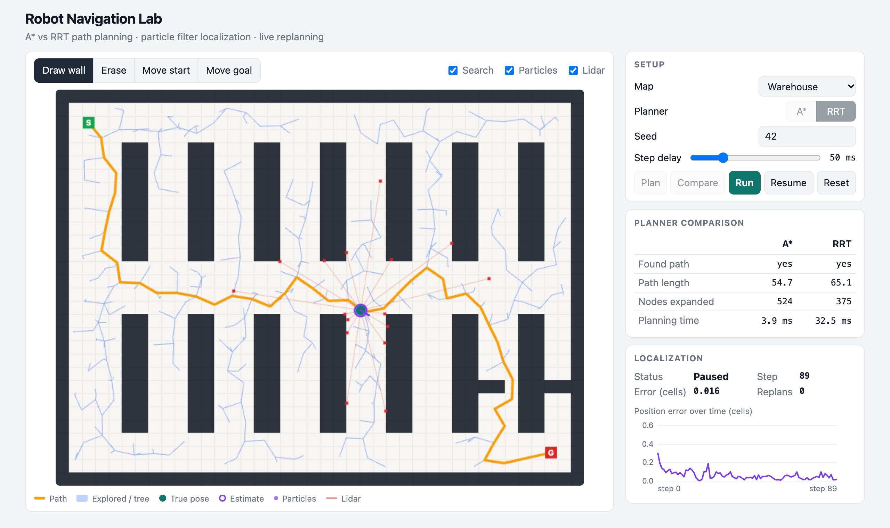

# Robot Navigation Lab

A browser-based 2D robot navigation simulator. Users draw a grid world or load a preset, plan a path with A\* or RRT, and watch a robot follow it under noisy motion while a particle filter localizes it from a simulated lidar. Walls drawn on the path mid-run trigger replanning.

All robotics code is plain Python and NumPy in a FastAPI backend (no ROS); the React frontend renders on an HTML canvas. No API keys, accounts, or paid services are required.



*RRT on the warehouse map. Blue: RRT tree. Orange: planned path. Red: the 16 lidar beams. The particles are hidden under the robot because the filter has converged (position error 0.016 cells).*

## Features

- **Grid editor**: draw and erase walls, move start and goal, load maze, warehouse, and open-field presets.
- **Path planning**: A\* and RRT, with visualization of explored cells or the RRT tree and a side-by-side comparison of path length, nodes expanded, and planning time.
- **Noisy motion**: rotate-then-drive motion with noise proportional to the size of each move.
- **Localization**: a 400-particle filter using a 16-beam simulated lidar, showing particles, estimated pose, true pose, and a live position-error chart.
- **Replanning**: when a new wall blocks the remaining path, or the robot is stuck for 8 steps, the backend replans from the estimated pose.
- **Reproducibility**: every random component is seeded.

## Results

Planner benchmark from `python scripts/benchmark.py` on an M4 Pro. A\* is deterministic and runs once; RRT results are the mean over 10 fixed seeds. Times are medians.

| Map | Planner | Success | Path length (cells) | Nodes expanded | Planning time (ms) |
|---|---|---|---|---|---|
| maze | A* | 100% | 119.8 | 315 | 0.9 |
| maze | RRT (mean of 10 seeds) | 100% | 142.2 | 1438 | 311.6 |
| open_field | A* | 100% | 45.9 | 245 | 0.8 |
| open_field | RRT (mean of 10 seeds) | 100% | 52.9 | 106 | 3.0 |
| warehouse | A* | 100% | 54.7 | 524 | 1.8 |
| warehouse | RRT (mean of 10 seeds) | 100% | 62.4 | 319 | 15.7 |

"Nodes expanded" is cells popped from the priority queue for A\* and nodes added to the tree for RRT.

- A\* paths are always shorter: A\* is optimal on the grid, while RRT keeps the first path it finds.
- On a 40×30 grid, A\* is also much faster. RRT's advantages appear in large, continuous, or high-dimensional spaces where building and searching a full grid is impractical.
- RRT needs about 14× more nodes in the maze, illustrating the narrow-passage problem of sampling-based planners: random samples rarely land inside corridors.

## Architecture

```
React (canvas) ◄──── WebSocket /ws/simulate: one message per step ────► FastAPI (main.py)
        │            ◄── "add wall" messages mid-run                        │
        └─────────── REST: maps, one-off planning ─────────────────────────► │
                                                                            ▼
                                                                    simulation.py
                                     ┌──────────────┬───────────────┬───────┴──────┐
                                planners.py     motion.py        sensor.py    particle_filter.py
                                (A*, RRT)       (noisy motion)   (DDA lidar)  (predict/weight/resample)
                                     └──────────────┴───── grid_map.py ─────────────┘
```

### Planning (`planners.py`)

- **A\***: 8-connected grid (straight moves cost 1, diagonals √2, no corner cutting) with the octile-distance heuristic. The heuristic is admissible, so returned paths are optimal; tests verify this against Dijkstra on random grids.
- **RRT**: samples a random point (the goal with 10% probability), extends the nearest tree node 1.5 cells toward it, and adds the node if the segment is collision-free with a clearance margin. Terminates when a new node can connect directly to the goal.
- Both return a common `PlanResult` for comparison.

### Motion and sensing (`motion.py`, `sensor.py`)

- One function applies the same noisy rotate-then-drive model to the robot and to every particle.
- The lidar uses DDA ray casting (stepping from cell boundary to cell boundary), vectorized so all 16 beams for all 400 particles are traced in one NumPy call.

### Localization (`particle_filter.py`)

1. **Predict**: move each particle with the robot's motion command plus noise.
2. **Weight**: ray-cast the lidar from each particle and compare with the real scan. Each beam's likelihood is a Gaussian on the range error mixed with a constant outlier term (`0.95·gauss + 0.05`), so a single unexpected beam, such as a newly drawn wall, cannot eliminate a good particle. Particles inside walls receive zero weight.
3. **Resample**: low-variance (systematic) resampling, performed only when the effective sample size drops below half, followed by small jitter to preserve diversity.

The pose estimate is the weighted mean of the particles, with headings averaged as unit vectors. A particle filter is used rather than a Kalman filter because it can represent multimodal beliefs, which are common in repetitive environments such as warehouses.

### Simulation (`simulation.py`)

The robot steers using its estimated pose, not its true pose, so localization quality directly affects driving. One seed is split into independent random streams (world noise, filter, planner) with NumPy's `SeedSequence`, so changing one component does not alter the randomness of the others.

### Tech stack

| Component | Role |
|---|---|
| Python 3.11, NumPy | Robotics code and vectorized ray casting |
| FastAPI, Uvicorn | REST endpoints and WebSocket streaming with Pydantic validation |
| WebSocket | One message per simulation step to the browser; wall edits back to the server |
| React, Vite | UI state and dev server/build |
| HTML canvas | Rendering 1,200 cells, 400 particles, and lidar beams at 20 fps |
| pytest, httpx | Algorithm tests and an end-to-end WebSocket test |
| oxlint | JavaScript linting |
| GitHub Actions | Tests, benchmark smoke test, and frontend lint and build |

## Quickstart

Requires conda and Node.js 20+. No `.env` file is needed.

```bash
conda create -n robot-navigation-lab python=3.11 -y
conda activate robot-navigation-lab
pip install -r requirements.txt
cd frontend && npm install && cd ..
```

Start the backend (http://localhost:8000):

```bash
cd backend && uvicorn app.main:app --reload --port 8000
```

In a second terminal, start the frontend (http://localhost:5173):

```bash
cd frontend && npm run dev
```

Then:

1. Select a map and click **Compare** to plan with both A\* and RRT.
2. Click **Run** to drive the robot; the particles converge and the error chart drops.
3. While it drives, select **Draw wall** and click on the path ahead of the robot to trigger replanning.
4. Change the **Seed** for a different, repeatable run.

Run the planner benchmark:

```bash
python scripts/benchmark.py
```

## Running tests

```bash
cd backend && python -m pytest -v
```

36 tests:

| File | Coverage |
|---|---|
| `test_planners.py` | A\* optimality vs Dijkstra, no-path cases, RRT path validity |
| `test_sensor.py` | Ray-casting distances, max range, vectorized vs single-ray agreement |
| `test_particle_filter.py` | Error falls below 0.4 cells from a 2.5-cell initial offset (fixed seed), resampling, angle averaging |
| `test_simulation.py` | Reaches the goal, reproducibility, replanning when blocked |
| `test_api.py` | REST endpoints and a live WebSocket run with a replan |

## Project structure

```
robot-navigation-lab/
├── LICENSE                        MIT license
├── requirements.txt               Pinned Python dependencies
├── .github/workflows/ci.yml       pytest, benchmark smoke test, frontend lint and build
├── docs/screenshot.png
├── scripts/benchmark.py           A* vs RRT on every preset; prints a Markdown table
├── backend/
│   ├── conftest.py                Makes the `app` package importable in tests
│   ├── pytest.ini
│   ├── app/
│   │   ├── grid_map.py            Occupancy grid, collision checks, preset maps
│   │   ├── planners.py            A* and RRT with shared PlanResult stats
│   │   ├── motion.py              Noisy rotate-then-drive model and waypoint controller
│   │   ├── sensor.py              Vectorized DDA ray casting and simulated lidar
│   │   ├── particle_filter.py     Monte Carlo localization
│   │   ├── simulation.py          Plan, drive, sense, localize, replan
│   │   └── main.py                REST endpoints and /ws/simulate WebSocket
│   └── tests/                     pytest suite (see Running tests)
└── frontend/
    ├── package.json               Dependencies and scripts (dev, build, lint)
    ├── vite.config.js             Proxies /api and /ws to FastAPI on :8000
    ├── index.html
    ├── .oxlintrc.json             Lint rules
    ├── public/favicon.svg
    └── src/
        ├── main.jsx               React entry point
        ├── App.jsx                Layout, state, controls, WebSocket handling
        ├── api.js                 fetch and WebSocket helpers
        ├── styles.css             Layout and light/dark theme
        └── components/
            ├── GridCanvas.jsx     Renders map, search, path, particles, lidar, robot; wall painting
            ├── ErrorChart.jsx     Position-error chart with hover tooltip
            └── StatsTable.jsx     A* vs RRT comparison table
```

## Design decisions

- **Grid coordinates**: cell `(x, y)` covers `[x, x+1) × [y, y+1)`; robot positions are continuous within cells.
- **Maze generation** uses a randomized depth-first search with a fixed seed.
- **Robust likelihood and jitter.** An early version collapsed onto a single particle in the first step because the likelihood was too sharp; a wider likelihood, the per-beam outlier floor, and post-resample jitter fixed it.
- **Collision-aware odometry.** When the robot bumps an obstacle and stops, the filter receives a zero-distance motion update (as wheel encoders would report) rather than the commanded motion, which previously caused the estimate to drift.
- **RRT clearance margin**, a simple form of obstacle inflation so paths do not graze wall corners.
- **WebSocket streaming** rather than polling, for lower latency and bidirectional wall edits during a run.

## Limitations and future work

- A\* and RRT only; RRT\* would shorten RRT's jagged paths by rewiring the tree.
- Replanning runs a full plan from scratch; incremental planners such as D\* Lite would reuse prior search effort.
- The filter can fail if no particle is near the true pose (for example, a kidnapped robot); there is no global relocalization.
- Localization error levels off at a floor set by sensor and motion noise.
- Single robot; the default grid is 40×30 cells.

## License

Code is released under the MIT License; see [LICENSE](LICENSE).
